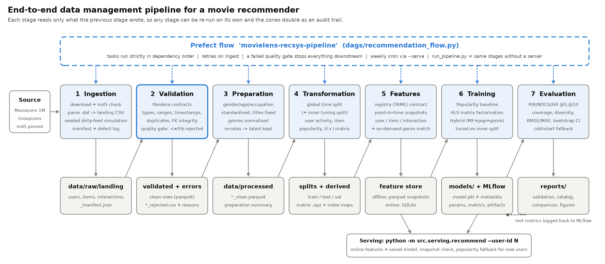
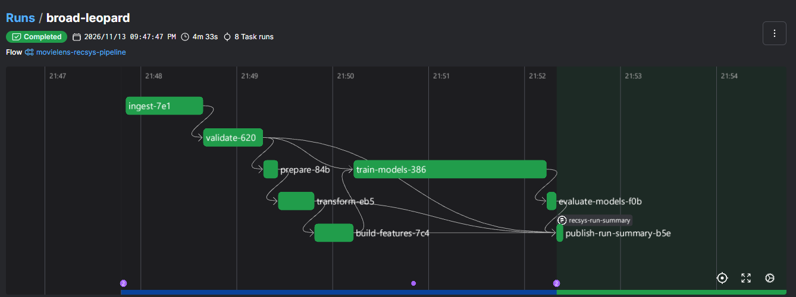

# MovieLens Recommendation Pipeline

DM4ML Assignment 2: an end-to-end data management pipeline for a movie recommender, built on MovieLens 1M (6,040 users, 3,883 movies, 1,000,209 ratings).

The pipeline downloads the data, validates it against written contracts, cleans and standardises it, splits it by time, builds a small feature store, trains three recommenders with MLflow tracking, evaluates them on the future, and runs the whole thing as a Prefect flow. Each stage writes its output to its own folder, so any stage can be re-run on its own and every intermediate result can be inspected.

## Results at a glance

Test period: everything after 2 December 2000. Scores are for the 1,138 users who appear in training and liked at least one movie (rated 4+) in the test period. K = 10.

| Model | Precision@10 | Recall@10 | NDCG@10 | Coverage | Diversity | RMSE | MAE |
| --- | --- | --- | --- | --- | --- | --- | --- |
| Popularity (baseline) | 0.196 | 0.052 | 0.212 | 0.037 | 0.655 | 0.961 | 0.761 |
| Matrix factorisation (ALS) | 0.038 | 0.013 | 0.033 | 0.089 | 0.622 | **0.889** | **0.695** |
| Hybrid (MF + popularity + genre) | **0.232** | **0.066** | **0.249** | 0.037 | **0.677** | n/a | n/a |

The hybrid beats the baseline on NDCG@10 by 0.037 (paired bootstrap 95% CI 0.029 to 0.045). Matrix factorisation predicts ratings best but ranks badly on its own; why that happens is covered in the report. Full tables: [reports/evaluation/model_comparison.md](reports/evaluation/model_comparison.md).

## Architecture



| Stage | Module | Writes to |
| --- | --- | --- |
| 1. Ingestion | `src/ingestion/` | `data/raw/landing/` (CSV + manifest + defect log) |
| 2. Validation | `src/validation/` | `data/validated/`, `data/errors/`, `reports/validation/` |
| 3. Preparation | `src/preparation/` | `data/processed/*_clean.parquet` |
| 4. Transformation | `src/transformation/` | `data/processed/splits/`, `data/processed/derived/` |
| 5. Features | `src/features/` | `data/features/<snapshot>/`, `data/features/online_store.db`, `reports/feature_catalog.md` |
| 6. Training | `src/training/` | `models/`, MLflow (`mlflow.db`, `mlartifacts/`) |
| 7. Evaluation | `src/evaluation/` | `reports/evaluation/`, `reports/figures/`, MLflow |
| Orchestration | `dags/recommendation_flow.py`, `run_pipeline.py` | `reports/pipeline_run_summary.md` |
| Serving | `src/serving/recommend.py` | stdout |

## Setup

Python 3.12.

```bash
git clone https://github.com/tabish-shibli/DM4ML_recommendation_pipeline.git
cd DM4ML_recommendation_pipeline
python -m venv .venv
# Windows: .venv\Scripts\activate      Linux/macOS: source .venv/bin/activate
pip install -r requirements.txt
```

**Windows note.** Prefect ships some files with very long names. If the project sits in a deep folder, `pip install` can fail with `No such file or directory` on a Prefect migration file because the full path passes the 260-character limit. Either enable long paths in Windows, or create the environment somewhere short, for example `python -m venv C:\venvs\recsys`, and activate that instead.

The dataset (5.9 MB) is downloaded on the first run and checked against a pinned MD5.

## Running it

### Option A: Prefect (orchestrated, with UI)

```bash
# terminal 1
prefect server start
# terminal 2
prefect config set PREFECT_API_URL=http://127.0.0.1:4200/api
python dags/recommendation_flow.py
```

Open <http://127.0.0.1:4200> to watch the run. To put it on a weekly schedule (Monday 02:00) instead of running once: `python dags/recommendation_flow.py --serve`.

### Option B: plain Python (no server)

```bash
python run_pipeline.py                      # all stages, about 4 minutes
python run_pipeline.py --from-stage train   # resume from a stage
python run_pipeline.py --only validate      # one stage
```

Both runners call the same stage functions from `src/pipeline.py`, in the same order.

### Recommendations for one user

```bash
python -m src.serving.recommend --user-id 953 --model hybrid --k 10
```

### Experiment tracking

```bash
mlflow ui --backend-store-uri sqlite:///mlflow.db --port 5000
```

### Tests

```bash
pytest
```

16 tests cover the metric maths, each validation check, the time split, point-in-time feature computation, the feature contract, title cleaning and the models.

## How each requirement is covered

**Ingestion.** `ingest.py` downloads `ml-1m.zip`, verifies the MD5, parses the three `::`-delimited files (Latin-1) into landing CSVs and writes `_manifest.json` with row counts and file hashes. MovieLens is a curated dataset with almost nothing for a validator to find, so a seeded simulator (`dirty_feed.py`) adds 3,416 realistic defects to the landing copy: duplicate events, blank keys, ratings like `"five"` or `7`, epoch-zero and year-2033 timestamps, events for unknown users and movies, and untidy user and movie fields. Every defect is logged to `_injected_anomalies.csv`. Set `simulate_dirty_feed: false` in the config to ingest the files exactly as published.

**Validation.** Data contracts are Pandera schemas (`schemas.py`) with two severities. *Critical* failures (missing key, wrong type, rating outside 1 to 5, timestamp outside the platform window, exact duplicate, user or movie that does not exist) send the row to `data/errors/<table>_rejected.csv` with the reason. *Warnings* (odd gender spelling, invalid age code, blank zip, malformed genre list, user re-rating a movie) keep the row and leave the fix to preparation. A quality gate stops the pipeline if more than 5% of any table is rejected. The report compares what was caught with the defect log: all 3,416 defects were caught by the expected check. See [reports/validation/validation_report.md](reports/validation/validation_report.md).

**Preparation and transformation.** Gender spellings standardised, age and occupation codes mapped to labels, 915 titles with a trailing article rewritten (`"Matrix, The"` to `"The Matrix"`), release year parsed, genre strings normalised, re-rated pairs collapsed to the latest rating. The split is a single global time cutoff at the 80th percentile of timestamps, with a leakage check, plus a second cutoff inside the training window for tuning. Derived datasets: user activity summary, item popularity, the user-item rating matrix (sparse `.npz` with index maps) and a genre matrix.

**Feature management.** `configs/feature_registry.yaml` defines every feature: entity, type, description, source and logic. The builder computes features as of a reference time from interactions on or before that time, and the store refuses to save output that does not match the registry. Two snapshots are written (tuning and training), the training one is published to a SQLite online store, and the serving path reads from there after checking that the store holds the snapshot the model was trained on. Catalog: [reports/feature_catalog.md](reports/feature_catalog.md).

**Training.** Popularity baseline; biased matrix factorisation solved by alternating least squares (vectorised numpy, under 30 s on the full matrix); a hybrid that blends the MF score with a popularity prior and a genre-match feature. MF regularisation is chosen by validation RMSE and the hybrid weights by validation NDCG@10, both on the inner split, never on test. Every configuration is an MLflow run with parameters, metrics and artifacts.

**Evaluation.** Precision, Recall, NDCG and Hit rate at 5 and 10, catalogue coverage, intra-list genre diversity, personalisation, novelty, RMSE and MAE, Precision/Recall curves up to K = 20, bootstrap confidence intervals, and a separate cold-start result for test users with no history.

**Orchestration.** Prefect tasks for each stage, with dependencies passed explicitly, retries on ingestion, a fan-in summary task and a Markdown artifact in the Prefect UI.

## Screenshots and report

| File | Shows |
| --- | --- |
| `reports/screenshots/prefect_flow_run.png` | Successful Prefect run: 8 tasks completed, dependency graph, live logs |
| `reports/screenshots/prefect_flow_graph.png` | The same run, graph only |
| `reports/screenshots/prefect_run_logs.png` | Pipeline log lines streamed into the Prefect UI |
| `reports/screenshots/prefect_run_summary_artifact.png` | Run summary artifact published by the last task |
| `reports/screenshots/mlflow_runs_table.png` | MLflow parent run with the 3 final models and 24 tuning runs nested under it |
| `reports/screenshots/mlflow_compare_final_models.png` | MLflow compare view: parameters and test metrics (columns: popularity, MF, hybrid) |

Final report (3 pages): [reports/2025ag05840_DM4ML_Assignment2_Report.pdf](reports/2025ag05840_DM4ML_Assignment2_Report.pdf)



## Troubleshooting

- `ConnectionResetError: [WinError 10054]` printed after `Flow run ... Finished in state Completed()` on Windows is asyncio noise at interpreter shutdown. The run has already finished and been recorded.
- If `python dags/recommendation_flow.py` runs but nothing appears in the UI, `PREFECT_API_URL` is not set in that terminal, so Prefect used a temporary in-process server.
- `SnapshotMismatch` from the serving command means the online feature store was rebuilt after the model was trained. Re-run from the `features` stage.

## Repository layout

```text
DM4ML_recommendation_pipeline/
├── configs/            pipeline.yaml, feature_registry.yaml
├── dags/               recommendation_flow.py (Prefect)
├── data/
│   ├── raw/            download + landing CSVs        (generated)
│   ├── validated/      rows that passed validation    (generated)
│   ├── processed/      clean tables, splits, derived  (generated)
│   ├── features/       offline snapshots + online db  (generated)
│   └── errors/         rejected and warned rows       (kept in git)
├── models/             trained models + registry.json (generated)
├── reports/            validation, feature catalog, evaluation, figures, screenshots, final report
├── scripts/            draw_architecture.py
├── src/                one package per stage + common/, serving/, pipeline.py
├── tests/
├── run_pipeline.py
└── requirements.txt
```

## Known limitations

- The validation window used for tuning is short (9 days, 367 users) because MovieLens activity spikes in November 2000. The chosen weights held up on test, but a longer window would be safer.
- The hybrid's gain comes mostly from favouring popular movies that are also well liked. Its coverage is as low as the baseline's (3.7% of the catalogue).
- Explicit-rating MF is not a good top-N ranker. An implicit-feedback model (for example weighted ALS on the binary matrix) would be the next thing to try.
- The defect simulation is designed to test the validator, not to reproduce any real platform's error rates.

## Data

F. Maxwell Harper and Joseph A. Konstan. 2015. The MovieLens Datasets: History and Context. ACM Transactions on Interactive Intelligent Systems 5(4). The data is downloaded from GroupLens at run time and is not redistributed in this repository.
